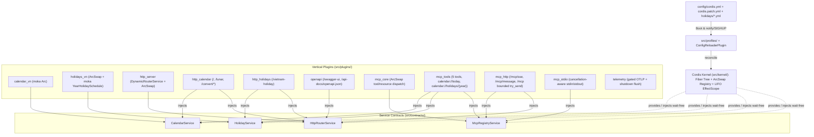

# Architecture Decision Record (ADR): VietCalendar Rust Architecture & Cordis Plugin Redesign

**Status:** Accepted & Implemented (`vietcalendar-rs` 0.2.0)

**Date:** 2026-11-21 (Initial Rust Port: 2026-08-17)

**Context:** Porting Vietnam Lunar Calendar from Java 11 / Vert.x to Rust (Axum & Tokio), followed by redesign into a clean, non-blocking, performance-focused Cordis-style plugin architecture.

---

## 1. Context and Problem Statement

The Vietnam Lunar Calendar application originally migrated from Java Vert.x to Rust (`axum`, `tokio`, `utoipa`, `tracing`). Phase 1 resolved several domain and API correctness issues:

1. **Gregorian / Lunar Date Incompatibility:** Storing Lunar dates in `chrono::NaiveDate` panicked on 30-day lunar February (`TD` resolved via `LunarDate`).
2. **Leap Month Algorithmic Flaw:** Passing `leap = 1` for all months in a leap year broke non-leap conversions.
3. **HTTP 200 OK Returned on Errors:** Handler `Result<Json<T>, String>` serialized errors as `200 OK`.
4. **Timezone Drift in `home` Endpoint:** Defaulting to `Local::now()` evaluated UTC inside containers instead of UTC+7.

A subsequent architectural review identified remaining structural bottlenecks and baseline debt (`TD-01`–`TD-08` in [`docs/PROJECT_ANALYSIS.md`](PROJECT_ANALYSIS.md)):
- Blocking `std::sync::RwLock<HashMap>` cloning entire `HashSet`s per request without timezone keys (`TD-02`), repeated Meeus trigonometry on every conversion, and silent day-30 rollover on 29-day *tháng thiếu* months (`TD-03`).
- Monolithic route/MCP/telemetry wiring inside `src/main.rs` and `src/mcp.rs`, duplicated holiday logic omitting compensatory leave (`TD-01`), unbounded SSE channels (`TD-07`), and hardcoded pre-2021 holiday logic unable to express Vietnam's per-year workday swap decrees (*ngày đi làm bù*, `TD-05`).

---

## 2. Decision Drivers

- **Non-Blocking Concurrency & Throughput:** Zero blocking locks on hot request paths; wait-free `ArcSwap` service/router/session snapshots, bounded `moka` W-TinyLFU caches, zero-alloc ISO date parsing, and bounded `mpsc::try_send` SSE backpressure.
- **Cordis-Style Spatiotemporal Composability:** Decoupled plugins communicating strictly via `src/contracts/` Service Definitions (`CalendarService`, `HolidayService`, `HttpRouterService`, `McpRegistryService`), lifecycle-bound `Fiber` trees, and LIFO `EffectScope` disposers with live YAML profile/patch hot-reload.
- **Data-Driven Legal Accuracy:** Exact per-year Vietnam MOLISA holiday tables (`config/holidays/<year>.yml`) supporting swapped working weekends (`working_weekends`), compensatory days, and bridge days.
- **Zero-Panic Production Safety:** Zero `.unwrap()` / `.expect()` across production `src/` paths, graceful `SIGTERM`/`SIGINT` unwinding, and gated OpenTelemetry flushing.

---

## 3. Key Architectural Decisions

### ADR-1 through ADR-11 (Historical Rust Port Decisions, 2026-08-17)

- **ADR-1 (`LunarDate` Domain Model):** Decoupled lunar dates from Gregorian `chrono::NaiveDate` via `LunarDate { day, month, year, is_leap }` (now in [`src/contracts/models.rs`](../src/contracts/models.rs)).
- **ADR-2 (Independent `is_leap_month`):** Scoped leap-month conversion explicitly to `is_leap_month: bool` (now in [`src/contracts/calendar.rs`](../src/contracts/calendar.rs)).
- **ADR-3 (`AppError` JSON Mapping):** Centralized `AppError` emitting `4xx`/`5xx` JSON [`ErrorResponse`](../src/contracts/models.rs) payloads (enhanced with `JsonQuery<T>` in [`src/plugins/http_server.rs`](../src/plugins/http_server.rs)).
- **ADR-4 (Fixed Vietnam Timezone Anchor UTC+7):** Anchored `GET /` and `get_today_lunar` / `calendar://today` to `(Utc::now() + Duration::hours(7)).date_naive()`.
- **ADR-5 (Dynamic Holiday & Compensatory Calculation):** Initial Rust port of holiday logic (superseded by **ADR-13** below).
- **ADR-6 (Two-Stage Non-Root Docker Build):** Pre-compiles dependencies before copying sources and executes as non-root `appuser` (`UID 10001`) in [`Dockerfile`](../Dockerfile).
- **ADR-7 (Symmetric ISO-8601 `/convert/.../{date}` Routes):** Standardized `/convert/solar-to-lunar/{date}` and `/convert/lunar-to-solar/{date}` alongside legacy `/lunar`.
- **ADR-8 (Dual-Mode CLI & MCP Stdio Support):** Exposed `serve` and `mcp` modes (`vietcalendar` + `vietcalendar-mcp`).
- **ADR-9 (Automated CI/CD & GHCR Publishing):** Enforced `fmt`, `clippy -D warnings`, `cargo test`, and GHCR publishing in [`.github/workflows/rust.yml`](../.github/workflows/rust.yml).
- **ADR-10 (Dependency Modernization & Rust 1.97 Docker Toolchain):** Updated core framework dependencies (`axum 0.8.9`, `tokio 1.53.1`, `utoipa 5.5.0`, `clap 4.6.6`, etc.).
- **ADR-11 (Remote MCP over HTTP/SSE + Direct HTTP POST + Permissive CORS):** Exposed `GET /mcp/sse`, `POST /mcp/message`, `POST /mcp`, and `POST /mcp/sse` with `CorsLayer` allowing `Any`.

---

### ADR-12: Native Cordis-Style Non-Blocking Plugin Kernel (`src/kernel/`, `src/contracts/`, `src/plugins/`)

- **Decision:** Re-architect `vietcalendar-rs` around a zero-domain Cordis plugin kernel ([`src/kernel/`](../src/kernel/mod.rs)) paired with Three-Role Service Contracts ([`src/contracts/`](../src/contracts/mod.rs)), decoupled vertical plugins ([`src/plugins/`](../src/plugins/mod.rs)), and YAML Profiles/Patches ([`src/profiles/`](../src/profiles/mod.rs), [`config/cordis.yml`](../config/cordis.yml), [`config/cordis.patch.yml`](../config/cordis.patch.yml)):
  1. **Wait-Free Hot Paths (`arc-swap` & `moka`):** `ServiceRegistry`, `HttpRouterEngine`, `McpCoreEngine`, and `McpSessionManager` publish immutable snapshots via `ArcSwap` for lock-free concurrent reads. `VietnamCalendarEngine` precomputes immutable `Arc<LunarSpan>` year layouts (giving O(1) conversions and strict 29/30-day lunar validation, resolving `TD-03`) cached in a bounded `moka::sync::Cache`, while replacing `is_solar_leap` with `CalendarService::is_lunar_leap_year` (`TD-04`).
  2. **Reversible LIFO Effects & Reactive Dependency Graph:** Plugins declare `provides`/`requires` metadata, spawn cancellation-bound tasks (`ctx.spawn`), and register disposers (`ctx.on_dispose` / `ctx.effect`) that unwind strictly in LIFO order on disposal, failed mount, live patch reconciliation, or `SIGTERM`/`SIGINT` shutdown.
  3. **Bounded Non-Blocking Streams & Live Hot-Reload:** `McpHttpPlugin` uses bounded `mpsc::channel` + `try_send` (`503` backpressure, `404` session validation on notifications, resolving `TD-07`), while `ConfigReloaderPlugin` bridges `notify` + Unix `SIGHUP` over a bounded debounced channel with atomic fail-safe YAML validation.
  4. **Clean Break on Internal Rust API:** Legacy root modules (`calendar.rs`, `services.rs`, `handlers.rs`, `mcp.rs`, `models.rs`), `is_solar_leap`, `is_solar_holiday`, and `conf/configuration.json` are removed while preserving 100% HTTP REST and MCP protocol compatibility.
- **Rationale:** Achieves DeepSeek Harness / Cordis modularity and live dynamic hot-swapping in safe, zero-`unsafe` native Rust without WASM FFI overhead or lock contention.
- **Verification:** 23 unit tests, 6 end-to-end integration tests, `cargo bench` microbenchmarks, and static zero-`.unwrap()` / `-D warnings` audits (`docs/specs/2026-11-21-cordis-plugin-kernel/` and `docs/specs/2026-11-21-nonblocking-plugin-refactor/`).

### ADR-13: Data-Driven Per-Year Vietnam Holiday Schedules with `working_weekends` Overrides

- **Decision:** Replaced hardcoded statutory holiday calculations in `services.rs` and the diverging duplicate `compute_holiday_list_for_year` in `mcp.rs` (`TD-01`, `TD-02`, `TD-05`) with a single `HolidayService` (`VietnamHolidaysPlugin` in [`src/plugins/holidays_vn/`](../src/plugins/holidays_vn/mod.rs)):
  1. Loads per-year YAML files from [`config/holidays/`](../config/holidays/2026.yml) (`2024.yml`, `2025.yml`, `2026.yml` shipped with official MOLISA holiday, compensatory, bridge-day, and `working_weekends` swaps).
  2. Evaluates dates against immutable `YearHolidaySchedule` binary-search vectors: `working_weekends` (*ngày đi làm bù*) return `false` even on Saturday/Sunday, configured `holiday_dates` return `true`, and otherwise `Sat`/`Sun` return `true`.
  3. Unconfigured years fall back strictly to **weekends-only** (`Sat`/`Sun`), while plugins can overlay reversible per-year schedules via `HolidayService::register_year_schedule` (`moka` cache invalidated automatically on reload or disposer unwind).
- **Rationale:** Real-world Vietnamese holidays change annually via government workday swap decrees that static formulas cannot reliably predict; sharing one `HolidayService` across HTTP and MCP eliminates drift (`TD-01`) and cache poisoning (`TD-02`).

### ADR-14: Shared `canchi_solar_vn` Substrate & Decoupled Thin Niche Plugins (`REQ-036..REQ-038, REQ-041` / `ADR-011`)

- **Decision:** Extracted Can Chi (`year`, `month` *Ngũ Hổ Độn*, JDN `day`, `hour` *Ngũ Thử Độn*, 30 *Nạp Âm*) and AA98 24 Solar Terms (*Tiết Khí*) into a shared [`CanChiSolarService`](../src/contracts/canchi.rs) (`canchi_solar_vn`), consumed uniformly by [`AstrologyPlugin`](../src/plugins/astrology_vn/mod.rs) (BaZi Four Pillars + Vietnamese Tử Vi Nam Phái Core ~50 stars), [`TrachNhatPlugin`](../src/plugins/trach_nhat_vn/mod.rs), [`http_niches`](../src/plugins/http_niches.rs), and [`mcp_niches`](../src/plugins/mcp_niches.rs) with bilingual `(id, name_vi, name_en)` DTOs.
- **Rationale:** Prevents astronomical calculation drift across niches, allows independent enable/disable of each niche via [`config/cordis.yml`](../config/cordis.yml) / [`config/cordis.patch.yml`](../config/cordis.patch.yml), and ensures Cordis LIFO dependency disposal cascades cleanly when any niche plugin is unmounted.

### ADR-15: Wait-Free Niche Caching, Stateless Recurrence, & Hot-Reloadable Retail Catalog (`REQ-039..REQ-040` / `ADR-012`)

- **Decision:**
  1. Cached 24 Solar Terms per `(year, tz_quarters)` inside a bounded `moka::sync::Cache` (capacity 256) in [`solar_terms.rs`](../src/plugins/canchi_solar_vn/solar_terms.rs).
  2. Implemented [`LunarRecurrencePlugin`](../src/plugins/recurrence_vn/mod.rs) strictly stateless (`<= 50` years) resolving `Day30Policy` (`Skip`/`LastDayOfMonth`), `LeapMonthPolicy`, and folded CRLF RFC 5545 `.ics` feeds with `VALARM`.
  3. Built [`RetailCalendarPlugin`](../src/plugins/retail_vn/mod.rs) atop `ArcSwap<RetailCatalog>`, strict `serde_yaml_ng` (`deny_unknown_fields`) validation on [`config/retail_events.yml`](../config/retail_events.yml) (14 peaks + algorithmic `monthly_mung_1_ram`), and atomic staging/commit inside [`ConfigReloaderPlugin`](../src/plugins/config_reloader.rs).
- **Rationale:** Keeps all request hot paths lock-free with zero server-side state corruption risk while maintaining hot-reload parity between holidays and retail campaigns.

---

## 4. Architecture Diagram

---

## 5. Module Map & Verification Matrix

| Module | Role |
| :--- | :--- |
| [`src/kernel/`](../src/kernel/mod.rs) | Zero-domain Cordis kernel: `Kernel`, `Context`, `Fiber`, `EffectScope` (LIFO), `ServiceRegistry` (`ArcSwap`), `EventBus`, YAML `reconcile`. |
| [`src/contracts/`](../src/contracts/mod.rs) | Trait seams (`CalendarService`, `HolidayService`, `HttpRouterService`, `McpRegistryService`) and DTOs (`DateMonthYear`, `LunarDate`, `YearHolidaySchedule`, `ErrorResponse`). |
| [`src/plugins/calendar_vn/`](../src/plugins/calendar_vn/mod.rs) | Meeus AA98 math + `moka`-cached `Arc<LunarSpan>`, strict 29/30-day validation (`TD-03`), exact `is_lunar_leap_year` (`TD-04`). |
| [`src/plugins/holidays_vn/`](../src/plugins/holidays_vn/mod.rs) | Non-blocking async YAML loader + `ArcSwap`/`moka` `HolidayService` (`working_weekends` + weekends-only fallback, `TD-01`/`TD-02`/`TD-05`). |
| [`src/plugins/canchi_solar_vn/`](../src/plugins/canchi_solar_vn/mod.rs) | Shared JDN Can Chi, Ngũ Hổ Độn, Ngũ Thử Độn, 30 Nạp Âm, and `moka`-cached 24 Tiết Khí solver. |
| [`src/plugins/astrology_vn/`](../src/plugins/astrology_vn/mod.rs) | BaZi Four Pillars (*Lập Xuân*/*Tiết Khí* splits, Hidden Stems, Ten Gods, Đại Vận) + Tử Vi Nam Phái Core (~50 stars, 12 palaces). |
| [`src/plugins/trach_nhat_vn/`](../src/plugins/trach_nhat_vn/mod.rs) | Hoàng Đạo hours/days, 12 Trực, 28 Tú, major taboos, Tam Tai/Kim Lâu/Hoang Ốc/Xung Tuổi age checks, `<= 366`-day search. |
| [`src/plugins/recurrence_vn/`](../src/plugins/recurrence_vn/mod.rs) | Stateless `<= 50`-year lunar recurrence with `Day30Policy`/`LeapMonthPolicy`, presets, and CRLF `<= 75`-octet `.ics` export. |
| [`src/plugins/retail_vn/`](../src/plugins/retail_vn/mod.rs) | Wait-free `ArcSwap` retail engine over strictly validated `config/retail_events.yml` (14 peaks + monthly Mùng 1/Rằm). |
| [`src/plugins/http_*.rs`](../src/plugins/http_server.rs) | Wait-free `DynamicRouterService`, `JsonQuery<T>`/`AppJson<T>`, zero-alloc `parse_ymd_ascii`, 5 niche HTTP/OpenAPI plugins (10 routes). |
| [`src/plugins/mcp_*.rs`](../src/plugins/mcp_core.rs) | Lock-free `McpCoreEngine`, 5 core + 11 niche MCP tools, 3 resource templates, cancellation-aware `stdio`, bounded `try_send` SSE. |
| [`src/plugins/config_reloader.rs`](../src/plugins/config_reloader.rs) | Debounced bounded-channel `notify` + `SIGHUP` fail-safe YAML hot-reload. |
| [`src/plugins/telemetry.rs`](../src/plugins/telemetry.rs) | Idempotent `tracing` subscriber, gated OTLP gRPC exporter, LIFO `TracerProvider::shutdown()`. |
| [`src/profiles/mod.rs`](../src/profiles/mod.rs) | YAML profile (`serve`, `mcp-stdio`, `http-only`) and patch reconciler with embedded fallback defaults. |
| [`tests/integration_test.rs`](../tests/integration_test.rs) | End-to-end profile boot, live unmount, HTTP `oneshot`, OpenAPI, MCP direct/SSE backpressure (`503`/`404`), and hot-reload tests. |
| [`benches/calendar_bench.rs`](../benches/calendar_bench.rs) | Criterion microbenchmarks for warm/cold conversions, holiday checks, ASCII date parse, and wait-free kernel injection. |

### Verification Matrix

| Area | Verification Test / Target | Expected Outcome | Status |
| :--- | :--- | :--- | :---: |
| **Cordis Kernel** | `kernel::tests::*` (6 unit tests) | LIFO effects, `ctx.fork` teardown, out-of-order mount, cycles, failed rollback, patch reconcile | Passed |
| **15,000-Day Equivalence & Validation** | `plugins::calendar_vn::tests::*` (5 tests) | 15k-day AA98 match across 3 timezones, strict day-30 rejection, exact `is_lunar_leap_year` | Passed |
| **Data-Driven Holidays & Overrides** | `plugins::holidays_vn::tests::*` (3 tests) | 2024–2026 MOLISA holidays + swapped working Saturdays, `2099` fallback, reversible override | Passed |
| **HTTP / OpenAPI / Live Unmount** | `test_http_rest_endpoints_end_to_end`, `test_live_plugin_unmount_*` | 5 REST routes, `JsonQuery` 400 JSON, no unused `LunarDate` schema, live unmount -> 404 | Passed |
| **MCP Tools, Templates & Bounded SSE** | `test_mcp_http_*`, `test_mcp_sse_*`, `vietcalendar-mcp` CLI | `get_year_holidays(2026)` parity, `404` unknown notification, `503` SSE backpressure | Passed |
| **Live YAML Hot-Reload** | `test_live_yaml_hot_reload_and_malformed_rollback` | `notify` auto-reloads `2031.yml` & patch; malformed YAML retains prior state | Passed |
| **Zero-Panic & Lint Safety** | `RUSTFLAGS="-D warnings"`, prod `.unwrap()` scan, `src/kernel/` isolation | 0 warnings, 0 production `.unwrap()`/`.expect()`, 0 domain imports in `kernel` | Passed |
