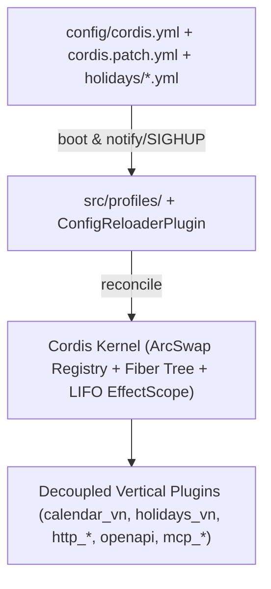

# Project Analysis — VietCalendar (`vietcalendar-rs`)

**Initial audit commit:** `e95a3d4` (`0.1.0`)  
**Current architecture:** `vietcalendar-rs` `0.2.0` (Cordis-style non-blocking plugin kernel + vertical plugins)  
**Analysis date:** 2026-11-21

---

## 1. Executive Summary & Repository Inventory

**VietCalendar** (`vietcalendar-rs`, Rust `edition = "2021"`) evolved from a monolithic Java 11 / Vert.x port (`0.1.0`) into a **non-blocking, Cordis-style plugin runtime (`0.2.0`)** composed from:

1. **Zero-Domain Cordis Kernel (`src/kernel/`):** `Context`, `Fiber` lifecycle tree, wait-free `ArcSwap` `ServiceRegistry`, LIFO `EffectScope` unwinders, lifecycle-bound `ctx.spawn` cancellation, and declarative YAML profile/patch reconciliation.
2. **Three-Role Service Contracts (`src/contracts/`):** `CalendarService`, `HolidayService`, `HttpRouterService`, and `McpRegistryService` decoupled from implementations.
3. **Vertical Plugins (`src/plugins/`):**
   - `VietnamCalendarPlugin`: Meeus AA98 math + bounded `moka` cache of immutable `Arc<LunarSpan>` layouts, O(1) conversions, strict 29/30-day validation, and exact `is_lunar_leap_year`.
   - `VietnamHolidaysPlugin`: Data-driven per-year YAML holiday schedules (`config/holidays/{2024,2025,2026}.yml`) honoring `working_weekends` (*làm bù*) with weekends-only fallback for unconfigured years.
   - `HttpServerPlugin`, `HttpCalendarPlugin`, `HttpHolidaysPlugin`, `OpenApiPlugin`: Wait-free `ArcSwap<Router>` & `ArcSwap<OpenApi>` dynamic composition, `JsonQuery<T>`, and zero-alloc `parse_ymd_ascii`.
   - `McpCorePlugin`, `McpToolsPlugin`, `McpStdioPlugin`, `McpHttpPlugin`: Lock-free MCP `2024-11-05` dispatcher, unified 5 tools & resource templates, cancellation-aware `stdio`, and bounded `mpsc::try_send` HTTP/SSE sessions.
   - `ConfigReloaderPlugin` & `TelemetryPlugin`: Debounced `notify` + `SIGHUP` fail-safe YAML hot-reload and gated OTLP gRPC export with LIFO `TracerProvider::shutdown()`.

### Current Module & File Map

| Path | Category | Role |
| :--- | :--- | :--- |
| [`Cargo.toml`](../Cargo.toml) | Build / Manifest | Crate dependencies (`arc-swap`, `moka`, `serde_yaml_ng`, `notify`, `criterion`), minimal `tokio` features, binary & bench targets. |
| [`Cargo.lock`](../Cargo.lock) | Build / Lockfile | Locked dependency graph (no longer excluded in `.gitignore`). |
| [`.gitignore`](../.gitignore) | Git config | Ignores `/target`, `.codegraph/`, `.idea/`. |
| [`src/lib.rs`](../src/lib.rs) | Rust Library Root | Exports `contracts`, `kernel`, `plugins`, `profiles`. |
| [`src/main.rs`](../src/main.rs) | Rust Binary (`vietcalendar`) | `clap` CLI (`serve`/`mcp` + `--config-dir`/`--profile`/`--port`) with `SIGTERM`/`SIGINT` graceful shutdown. |
| [`src/bin/vietcalendar-mcp.rs`](../src/bin/vietcalendar-mcp.rs) | Rust Binary (`vietcalendar-mcp`) | Standalone binary booting the `mcp-stdio` Cordis profile until `stdin` EOF or signal. |
| [`src/kernel/`](../src/kernel/mod.rs) | Cordis Kernel | `Context`, `Fiber`, `EffectScope`, `EventBus`, `ServiceRegistry`, `reconcile` (6 unit tests). |
| [`src/contracts/`](../src/contracts/mod.rs) | Service Contracts | Shared DTOs (`DateMonthYear`, `LunarDate`, `YearHolidaySchedule`, `ErrorResponse`) and trait seams (3 unit tests). |
| [`src/plugins/`](../src/plugins/mod.rs) | Vertical Plugins | 12 decoupled plugins for calendar, holidays, HTTP, OpenAPI, MCP, telemetry, and live config hot-reload (14 unit tests). |
| [`src/profiles/mod.rs`](../src/profiles/mod.rs) | Profile Loader | `PluginFactoryRegistry` + YAML loader (`serve`, `mcp-stdio`, `http-only`) with embedded defaults. |
| [`config/cordis.yml`](../config/cordis.yml) | Runtime Config | Declarative profile definitions (`serve`, `mcp-stdio`, `http-only`). |
| [`config/cordis.patch.yml`](../config/cordis.patch.yml) | Runtime Overrides | Deep-merged plugin override rules. |
| [`config/holidays/`](../config/holidays/2026.yml) | Holiday Data | Official MOLISA 2024–2026 YAML holiday & `working_weekends` schedules (`2024.yml`, `2025.yml`, `2026.yml`). |
| [`tests/integration_test.rs`](../tests/integration_test.rs) | Integration Tests | Profile boots, HTTP `oneshot`, OpenAPI, live unmount, bounded SSE (`503`/`404`), and `notify` hot-reload (6 tests). |
| [`benches/calendar_bench.rs`](../benches/calendar_bench.rs) | Microbenchmarks | Criterion benchmarks for warm/cold conversions, holiday lookup, ASCII parsing, and wait-free injection. |
| [`Dockerfile`](../Dockerfile) | Containerization | Two-stage `rust:1.97` -> `debian:bookworm-slim` build bundling `/etc/vietcalendar/config`, non-root `appuser`. |
| [`.github/workflows/rust.yml`](../.github/workflows/rust.yml) | CI/CD | Runs `cargo fmt`, `cargo clippy -- -D warnings`, `cargo test`, and Docker GHCR publish (`ghcr.io`). |
| [`load_test.js`](../load_test.js) | Performance Testing | Grafana `k6` multi-stage ramp-up script targeting 5 REST endpoints (`p95 < 10ms`). |
| [`AGENTS.md`](../AGENTS.md) | Agent Instructions | Canonical AI agent directives, Cordis/domain invariants, and spec workflow. |
| [`docs/RUST_STYLE_GUIDE.md`](RUST_STYLE_GUIDE.md) | Coding Standards | Pragmatic Idiomatic Rust guide. |
| [`docs/specs/INDEX.md`](specs/INDEX.md) | Feature Specs | 7 five-document packages (`REQ-001`–`REQ-035`, `ADR-001`–`ADR-010`). |

### Toolchain Matrix

| Surface | Details |
| :--- | :--- |
| Container / CI | `Dockerfile` builds on `rust:1.97`; GitHub Actions uses `dtolnay/rust-toolchain@stable` (`rustfmt`, `clippy`). |
| Local host | `rustc 1.92.0` / `cargo 1.92.0` (`rustfmt` and `clippy` not installed on local RPM; verified locally with `RUSTFLAGS="-D warnings"`). |

---

## 2. Architecture & Performance Overview

### Measured Criterion Microbenchmarks (`0.2.0`)

| Benchmark | Median Time | Implementation Backing |
| :--- | :---: | :--- |
| `http_parse_ymd_ascii` | `19.38 ns` | Zero-allocation byte-slice `YYYY-MM-DD` parser (`src/plugins/http_calendar.rs`) |
| `kernel_wait_free_inject` | `58.82 ns` | Wait-free `ArcSwap` `ServiceRegistry::get` (`src/kernel/registry.rs`) |
| `holiday_is_holiday_warm` | `216.83 ns` | `moka` cache + sorted `YearHolidaySchedule` binary search (`src/plugins/holidays_vn/`) |
| `calendar_to_solar_warm` | `244.89 ns` | `moka`-cached `Arc<LunarSpan>` O(1) slot lookup + strict 29/30-day check |
| `calendar_to_lunar_warm` | `459.36 ns` | `moka`-cached `Arc<LunarSpan>` partition-point lookup |
| `calendar_lunar_span_cold` | `6.28 µs` | One-time Meeus AA98 computation per `(anchor_year, tz_quarter_hours)` |

---

## 3. Test Suite Inventory (`0.2.0`)

All **29 tests** (`23` unit + `6` integration) and `6` Criterion benchmark targets compile cleanly with `RUSTFLAGS="-D warnings"` and pass (`0` ignored):

| Test Location | Count | Coverage |
| :--- | :---: | :--- |
| `src/kernel/mod.rs` | 6 | LIFO effect order, `ctx.spawn` cancellation, `ctx.fork` child teardown, reactive out-of-order mount & cascade suspend, cycle & failed-mount rollback, profile patch reconciliation |
| `src/contracts/models.rs` | 3 | `DateMonthYear` `"MM"`/`"mm"`/`leap` Serde, `LunarDate` Serde, `YearHolidaySchedule` `working_weekends` precedence |
| `src/plugins/calendar_vn/` | 5 | JD 1582 boundary, AA98 bounds, 15,000-day Meeus AA98 equivalence across `7.0`/`8.0`/`-5.0` timezones, strict day-30 rejection, exact `is_lunar_leap_year` |
| `src/plugins/holidays_vn/` | 3 | 2024–2026 official MOLISA YAML schedules + swapped working Saturdays, `2099` weekends-only fallback, reversible plugin override disposers |
| `src/plugins/http_*` & `telemetry` & `mcp_http` | 6 | Zero-alloc `parse_ymd_ascii`, `AppError`, live router mount/unmount, bind failure error propagation, gated telemetry, bounded `try_send` SSE backpressure |
| [`tests/integration_test.rs`](../tests/integration_test.rs) | 6 | Full profile boots (`serve`, `http-only`, `mcp-stdio`), HTTP `oneshot` + `JsonQuery` 400 JSON + OpenAPI/Swagger, live plugin unmount -> `404`, MCP direct POST + `get_year_holidays(2026)` + templates, SSE `404` notifications + `503` backpressure, and live `notify` hot-reload + malformed YAML rollback |

---

## 4. Catalog of Discovered Quirks, Bugs & Technical Debt

Baseline technical debt items `TD-01`–`TD-08` identified during the initial audit at `e95a3d4` have **all been resolved** in the `0.2.0` Cordis plugin redesign (`docs/specs/2026-11-21-nonblocking-plugin-refactor/`):

| ID | Original Severity | Legacy Finding | Resolution in `0.2.0` |
| :--- | :---: | :--- | :--- |
| **TD-01** | **P1** | Legacy `src/mcp.rs::compute_holiday_list_for_year` omitted compensatory leave (`nghỉ bù`) and duplicated `src/services.rs`. | **Resolved (`REQ-029`, `REQ-031`):** `McpToolsPlugin` delegates `get_year_holidays` and `calendar://holidays/{year}` directly to the shared data-driven `HolidayService`. |
| **TD-02** | **P1** | Legacy `HOLIDAY_CACHE` keyed only by `solar_year` behind a blocking `std::sync::RwLock`, risking timezone cache poisoning and lock contention. | **Resolved (`REQ-029`, `ADR-009`):** `VietnamHolidaysPlugin` stores immutable `Arc<YearHolidaySchedule>` entries in `ArcSwap` + bounded `moka` cache with explicit timezone validation and zero request-path locks. |
| **TD-03** | **P1** | Legacy `convert_lunar_to_solar` allowed day-30 rollover on 29-day *tháng thiếu* months, lacked `1..=12` checks, and MCP cast `i64 as i32`. | **Resolved (`REQ-027`, `REQ-031`):** `VietnamCalendarPlugin` validates `1..=12` and exact 29/30-day `LunarSpan` lengths; `McpToolsPlugin` uses checked `i32::try_from`/`u32::try_from`. |
| **TD-04** | **P2** | Legacy `services::is_solar_leap` evaluated Metonic `year % 19` under a misleading solar-leap name. | **Resolved (`REQ-028`):** Removed `is_solar_leap` and `is_solar_holiday`; replaced with astronomically exact `CalendarService::is_lunar_leap_year`. |
| **TD-05** | **P2** | Hardcoded pre-2021 holiday rules could not reflect Vietnam's per-year decrees or swapped working Saturdays (*làm bù*). | **Resolved (`REQ-029`, `ADR-010`):** Replaced with data-driven `config/holidays/<year>.yml` schedules (`2024`, `2025`, `2026` shipped) supporting `working_weekends` and weekends-only fallback. |
| **TD-06** | **P2** | OpenAPI `IntoParams` exposed `time_zone`, `ApiDoc` registered unused `LunarDate`, Axum `Query` rejections emitted plain text, and `/vietnam-holiday` lacked `timezone`. | **Resolved (`REQ-030`):** Fixed `#[param(rename = "timezone")]`, omitted `LunarDate` from HTTP schemas, added `JsonQuery<T>` JSON `400` errors, and added `timezone` on `/vietnam-holiday`. |
| **TD-07** | **P2** | Unconditional OTLP exporter, missing graceful shutdown flush, production `.unwrap()` calls, unbounded SSE channels, unvalidated `sessionId` on notifications, hardcoded `calendar://holidays/2026`, `tokio` `full`. | **Resolved (`REQ-031`–`REQ-033`):** Gated OTLP on `OTEL_EXPORTER_OTLP_ENDPOINT`/config with LIFO `TracerProvider::shutdown()`, `0` production `.unwrap()`/`.expect()` calls, bounded SSE `try_send` (`503`), `404` notification checks, dynamic current-year URI + `resources/templates/list`, and minimal `tokio` features. |
| **TD-08** | **P3** | Unused `conf/configuration.json`, `Cargo.lock` in `.gitignore`, dead `#[allow(non_snake_case)]`, legacy JavaDoc/dead comments, doc link drift, missing HTTP/MCP tests. | **Resolved (`REQ-028`, `REQ-033`–`REQ-035`):** Deleted `conf/` and legacy monolithic `.rs` files, cleaned `.gitignore` and docs, added HTTP `oneshot`, SSE, hot-reload, and Criterion suites. |

---

## 5. Remaining Notes

- Local environment (`rustc 1.92.0`) lacks `rustfmt` and `clippy` components; CI (`.github/workflows/rust.yml`) enforces `cargo fmt --all -- --check` and `cargo clippy -- -D warnings` on `stable`.
- All 7 spec packages under [`docs/specs/INDEX.md`](specs/INDEX.md) sit at `In-Testing` awaiting final human confirmation after real-world deployment verification to advance to `Verified`.
